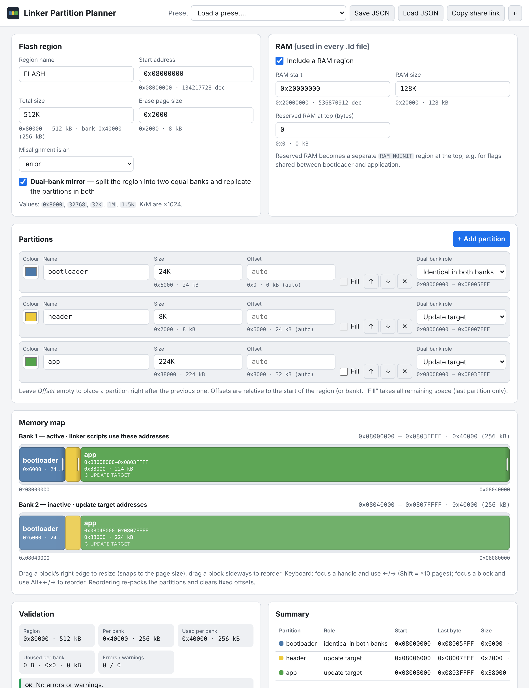

# Linker Partition Planner

A static, browser-only tool for planning flash/RAM partitions and generating **GNU ld linker scripts** — one per partition — plus a shared C header. No backend, nothing is uploaded.



## Features

- **Region + partitions**: set region start/size and erase page size, add partitions (name, size, optional fixed offset, colour). The last partition can *fill remaining space*.
- **Forgiving input**: `0x8000`, `32768`, `32K`, `1M`, `1.5K` (K/M = ×1024). All maths is exact integer (`BigInt`). Every value is echoed in hex **and** kB (`0x6000 · 24 kB`, or `1 kB + 12 B` when not round).
- **Live map**: proportional blocks, hatched gaps/free space, tooltips with exact addresses. Drag a block's right edge to resize (snaps to page size), drag a block to reorder; typed values and graphic stay in sync. Keyboard: handle ←/→ (Shift ×10), block Alt+←/→, row ↑/↓ buttons.
- **Validation**: overlap, exceeding the region, gaps, page misalignment (error *or* warning), zero/negative sizes, bad/duplicate names, RAM reserve, and the *bytes unused* total.
- **Dual-bank mirror** (see below).
- **RAM split** (optional, see below): carve RAM into regions, give each partition its own, and add a shared no-init area.
- **Output**: per-partition `<name>.ld`, `memory_map.h`, tabs with syntax highlighting, copy / download / **zip** (built client-side).
- **Persistence & sharing**: JSON save/load, automatic localStorage, shareable URL hash (`#c=…`), presets, light/dark theme.

## Generated files

Each `<name>.ld` contains the partition as `ROM` plus an optional `RAM`:

```
MEMORY
{
  ROM (rx) : org = 0x08008000, len = 0x38000
  RAM (xrw) : org = 0x20000000, len = 0x20000
}
```

Options:

| Option | Effect |
| --- | --- |
| Output mode | *MEMORY only* (paste into e.g. a STM32CubeMX script) or a *complete Cortex-M template* (`ENTRY(Reset_Handler)`, `.isr_vector`, `.text`, `.rodata`, `.data`, `.bss`, heap/stack symbols). The template is a **starting point** — review it. |
| Expressions | `len = 0x40000 - 0x8000` instead of a literal |
| Symbols | `PROVIDE(_app_start / _app_size / _app_end …)` for every partition |
| Reserved RAM at top | Splits off `RAM_NOINIT` (and a `.noinit` section in the full template) for flags shared by bootloader and app |

`memory_map.h` defines `PART_<NAME>_START / _SIZE / _END` (END is **exclusive**), region/page/bank constants, RAM constants, and in dual-bank mode `PART_<NAME>_INACTIVE_START / _END`. Include it from both bootloader and application so the layout has one source of truth.

## RAM split

By default the whole RAM is one `RAM` region (optionally with *Reserved RAM at top*), exactly as before. Click **Split RAM into regions** to define named RAM regions instead:

- Regions have a name, size, optional offset, colour and *Fill* (last region), and are shown on their own draggable map (resize snaps to a configurable step, default `0x100`; keyboard and reorder work like the flash map).
- Each partition has a **RAM region** selector; its `.ld` gets that region as `RAM`. Unassigned partitions use the first normal region.
- At most one region can be flagged **No-init**: it is added to every script as `RAM_NOINIT` (plus a `.noinit` section in the full template) for flags shared between bootloader and application.
- Splitting an existing layout converts the reserved-at-top value into an equivalent main + no-init pair, so the generated `MEMORY` block does not change. *Merge back* reverses it.
- Output: `RAM_REGION_<NAME>_START/_SIZE/_END` in `memory_map.h`, and `_ram_<name>_start/_size/_end` symbols.

RAM verification (shown inline): overlaps (to share RAM, assign both partitions to the same region), regions past the end of RAM, zero/negative sizes, gaps, 8-byte alignment, duplicate/empty names, more than one no-init region, partitions pointing at a missing or no-init region, regions too small for the template's heap + stack (full template only), and the *bytes RAM unused* total.

**Compatibility:** every new field is optional. Saved JSON, localStorage data and share links created before the RAM split existed load unchanged and generate identical files (covered by tests).

## Dual-bank mode

Enabling **Dual-bank mirror** splits the region into two equal banks. You define the partitions **once**, with offsets relative to the bank start; they are replicated in both banks, which are shown stacked.

- Each partition is marked **identical in both banks** (e.g. bootloader) or **update target** (e.g. header, app).
- Linker scripts use the **bank 1 addresses**: after a bank swap the running code is mapped at the same addresses.
- The summary table and `memory_map.h` list the **inactive bank** address of each partition (bank 1 + bank size) — where an update image is written.
- Page-alignment is checked against the bank size too.

Preset *STM32C562RE dual-bank*: `0x08000000`, 512K, 8K pages; per bank bootloader 24K + header 8K + app 224K → `app` is `org = 0x08008000, len = 0x38000`, inactive copy at `0x08048000`.

Note: reordering partitions (by drag or buttons) re-packs them back to back and clears fixed offsets.

## Development

```bash
npm install
npm run dev      # local dev server
npm test         # Vitest (units, layout, validation, .ld snapshots, zip, sharing)
npm run build    # typecheck + production build into dist/
```

Source layout: `src/core/` is pure TypeScript (parsing, layout, validation, generation, zip, sharing) and is fully unit-tested; `src/ui/` is the DOM layer.

## Deploying to GitHub Pages

`.github/workflows/deploy.yml` runs tests and the build on every push/PR, and deploys `dist/` to GitHub Pages on pushes to `main`.

1. In the repository go to **Settings → Pages** and set **Source** to **GitHub Actions**.
2. Push to `main`. The site appears at `https://<user>.github.io/<repo>/`.

The build uses a relative base (`./`), so it works under any sub-path.

## License

[MIT](LICENSE)
